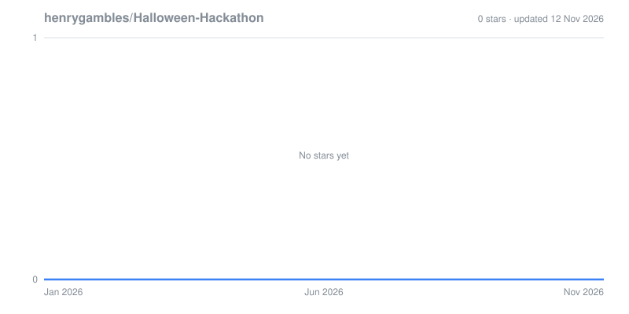

# Halloween Hackathon 🎃🕸️

Welcome, brave coder! This repo is your haunted playground for shipping spooky features fast. Mind the cobwebs, beware the merge ghosts, and have a fang-tastic time. 🧛

## Quick Start 🏃‍♂️💨

```bash
pnpm install      # mix the potion
pnpm dev          # summon the dev server
pnpm build        # bottle a production brew
pnpm start        # raise the built app from the crypt
```

## Potions & Spells (Scripts) 🪄

- `pnpm dev` – live-reloading séance for local hacking.
- `pnpm build` – compiles the client and bundles the server into `dist`.
- `pnpm start` – runs the production ghost once built.
- `pnpm check` – TypeScript wards to keep bugs at bay.
- `pnpm test` – Vitest familiars to guard against regressions.
- `pnpm format` – prettifies your incantations.

## Environment Grimoires 🔮

- `VITE_APP_TITLE` – title that haunts the browser tab.
- `VITE_APP_LOGO` – optional logo override (we ship with a 🎃 favicon by default).
- `VITE_ANALYTICS_ENDPOINT` / `VITE_ANALYTICS_WEBSITE_ID` – feed your spectral analytics.
- `VITE_OAUTH_PORTAL_URL` / `VITE_APP_ID` – portal runes for auth callbacks.

Place your secrets in a `.env` beside `vite.config.ts` (never in the light of day).

## Project Map 🗺️

- `client/` – React front-end cauldron stirred by Vite.
- `server/` – Express familiars and Vite middleware for dev.
- `shared/` – shared runes for both realms.
- `client/public/favicon.svg` – our pumpkin charm now guarding the tab.

## Contributing Without Becoming a Ghost 👻

1. Branch off `main` (or the current moon phase).
2. Make your changes; keep the puns grave but tasteful.
3. Run `pnpm check && pnpm test` before you howl at PR reviews.
4. Describe your spells clearly so reviewers don’t get jump-scares.

## Trick-or-Treat Tips 🍬

- Small commits keep the codebase less terrifying.
- Screenshots or GIFs are like leaving a lantern on—super helpful.
- If something feels cursed, add a comment or TODO to warn future mortals.

## Need Help? 🦇

Open an issue, ping the coven, or drop a bat-signal. No question is too ghoulish.

Happy haunting and happy shipping! 🎃💀👻

## Star History


